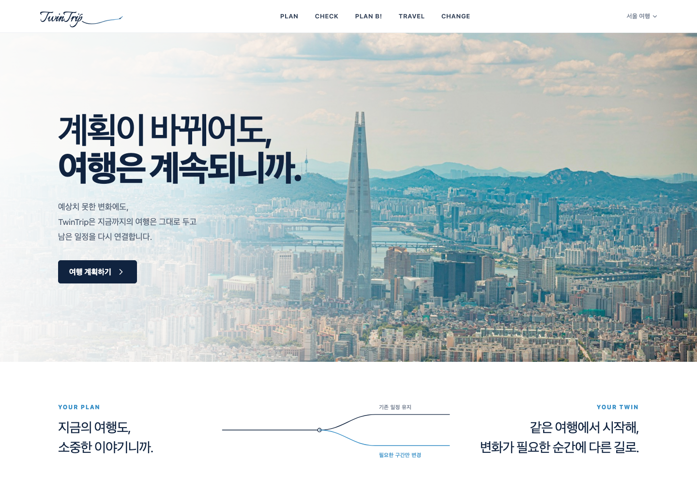
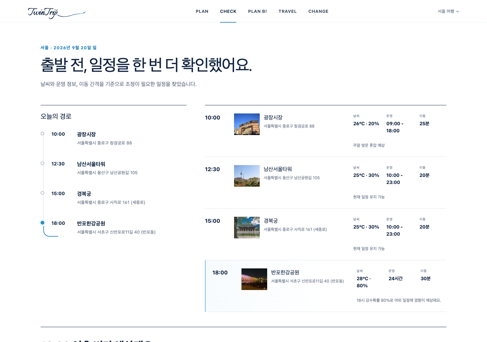
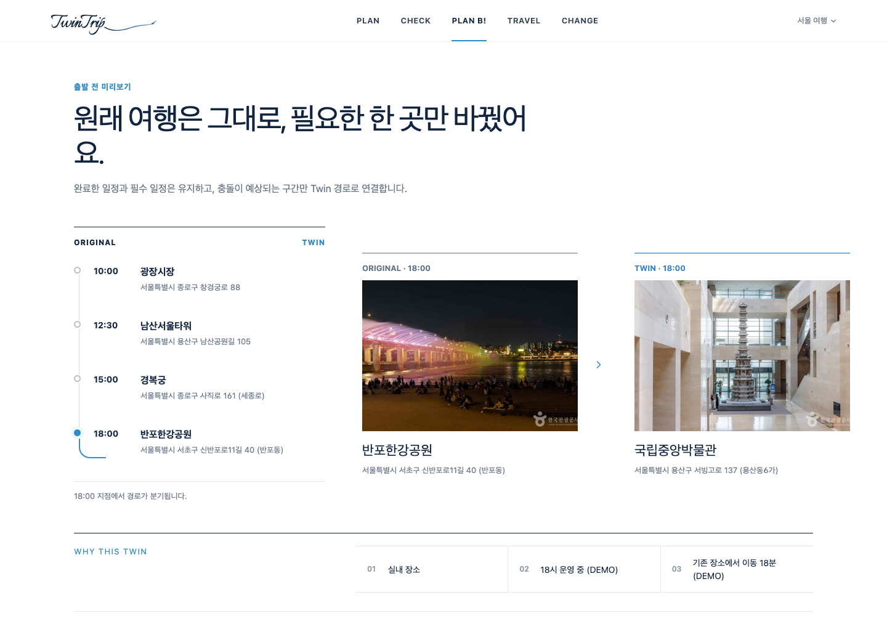
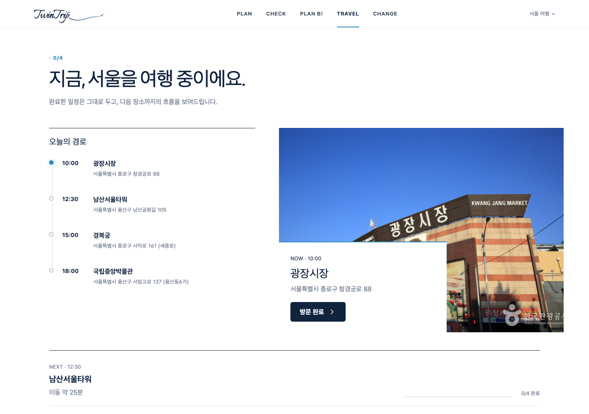
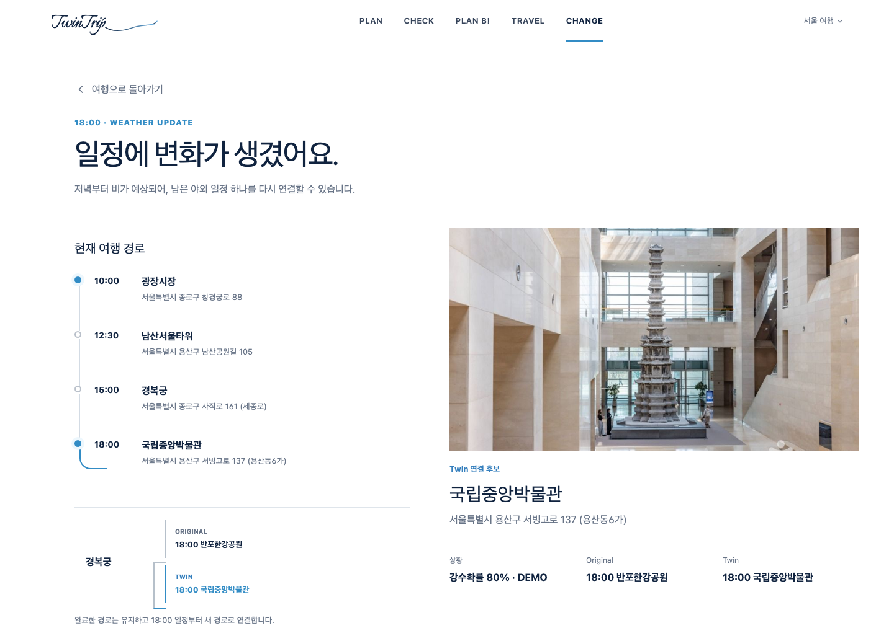

# TwinTrip

**계획이 바뀌어도, 여행은 계속되니까.**

공모전에서 제작한 여행 일정 관리 웹 MVP입니다. 여행 계획을 만들고 출발 전에 일정 간격을 점검한 뒤, 여행 중 변화가 생기는 데모 상황에서 필요한 한 곳을 대체하는 흐름을 구현했습니다.



## 제작 배경

여행에서는 갑작스러운 비나 일정 지연 때문에 세워둔 계획을 바꿔야 하는 순간이 생깁니다. TwinTrip은 기존 여행을 모두 다시 짜기보다, 원래 일정 **Original**을 보존하면서 변경이 필요한 구간을 대체 일정 **Twin**으로 연결하는 아이디어에서 출발했습니다.

이 저장소는 그 흐름을 화면과 상태 관리로 구현한 공모전 MVP입니다. 실시간 여행 최적화나 개인화 AI 추천 서비스로 완성된 상태는 아닙니다.

## 실제 구현 범위

| 기능 | 코드에 구현된 동작 |
| --- | --- |
| PLAN · 여행 계획 | 여행명·지역·기간 입력, 날짜별 일정 관리, 방문 시간·체류시간 수정, 일정 삭제, 필수 유지(MUST KEEP) 지정 |
| 관광지 검색 | 한국관광공사 TourAPI 키워드 검색, 관광지 상세 조회, 이미지 조회 및 이미지가 없는 경우 추가 조회 |
| CHECK · 출발 전 점검 | 입력한 방문 시각 간격과 체류시간을 비교해 충돌 표시, 원본·확정 일정 저장 |
| PLAN B · 대체 일정 | 변경 가능한 충돌 일정 한 곳을 정해 원본과 대체 장소 비교, 적용 후 확정 일정 갱신 |
| TRAVEL · 여행 진행 | 현재·다음 장소 표시, 사용자의 방문 완료 처리, 실제 완료 시각 기록, 완료 개수와 진행률 표시 |
| CHANGE · 상황 변화 | 버튼으로 데모 날씨 변화 발생, 영향받는 일정과 대체 흐름 표시 |
| 데이터 보존 | localStorage에 계획·원본·확정·진행·대체 일정과 변경 기록 저장 |
| 화면 | 반응형 레이아웃, 경로 흐름과 변경 전후 비교 UI |

대체 일정의 주 흐름은 `/trip/replan`입니다. 필수 유지·완료·현재 상태를 검사해 교체 대상에서 제외하는 로직이 있으며, 데모에서는 국립중앙박물관을 대안으로 사용합니다. 일반 일정에서는 대상 장소 주변의 TourAPI 결과에서 이미 일정에 포함된 장소를 제외하고 최대 3개를 보관하며, 현재 화면은 첫 번째 후보를 사용합니다. 여러 후보를 AI로 평가해 최적 경로를 구하는 기능은 아닙니다.

## AI·추천·실시간 데이터의 구현 수준

| 항목 | 현재 상태 |
| --- | --- |
| 관광정보 | TourAPI 검색·주변·상세·이미지 요청 코드 구현. 유효한 API 키 필요 |
| 일정 충돌 점검 | 프런트엔드의 규칙 기반 계산. 데모의 비 예보는 고정 시나리오 |
| 대체 장소 선택 | 데모 지정 장소 또는 주변 관광지 조회 결과를 사용. 학습된 개인화 추천 모델 없음 |
| OpenAI 호출 | `POST /api/ai/recommend`에 `gpt-4.1-mini` 호출 코드가 있으나 **현재 화면에서 호출하지 않음** |
| AI API의 대체 처리 | 키가 없거나 요청·응답 처리에 실패하면 첫 번째 후보와 고정 설명을 반환. 이 결과는 AI 추론이 아님 |
| 후보 점수 API | `/api/trip/replan`에 입력값으로 점수를 계산하는 규칙 기반 API가 있으나 현재 화면에서는 미사용 |
| 점검 API | `/api/trip/check`는 전달받은 강수확률로 위험과 점수를 계산하며 현재 화면에서는 미사용 |
| 날씨·길찾기 | `/api/weather`, `/api/directions`는 미연결 안내만 반환. 키를 입력해도 제공기관 어댑터는 별도 구현 필요 |

화면의 강수확률 80%, 이동 18분·25분, 혼잡도, 일부 운영시간과 지연 30분은 데모·고정 표시입니다. 실제 예보, 경로 탐색, GPS 추적 또는 실시간 혼잡도 수집 결과가 아닙니다. 일반 일정의 ‘남은 일정 확인’도 현재 구현에서는 같은 데모 변화 함수를 호출합니다.

서울 추천 장소 목록은 코드에 지정된 장소를 TourAPI로 조회한 것이며, 인기 순위나 사용자 취향을 분석한 결과가 아닙니다. AI 모델 학습, 예약·결제, 회원가입, 서버 DB 저장, 기기 간 동기화는 포함하지 않습니다.

## 기술 스택

| 영역 | 실제 사용 기술 |
| --- | --- |
| 언어·화면 | TypeScript, React 19, CSS |
| 라우팅·빌드 | vinext 1.0 beta(App Router 호환), Vite 8 |
| 스타일 빌드 | Tailwind CSS 4, PostCSS; Vercel 빌드에는 Tailwind Vite 플러그인 |
| 데이터 연동 | Fetch API, 한국관광공사 TourAPI REST API |
| 클라이언트 저장 | Web Storage API(localStorage) |
| 별도 AI API | OpenAI Chat Completions REST 호출 코드; 화면과 미연결 |
| 실행·배포 설정 | Cloudflare Vite 플러그인·Wrangler, Nitro Vercel 빌드 |
| 개발 도구 | oxlint, oxfmt, npm |

`components/ui/`에는 초기 프로젝트의 UI 컴포넌트 모음이 포함되어 있지만, 현재 주요 화면은 `app/page.tsx`와 자체 아이콘·CSS로 구성되어 있습니다. 패키지에 포함된 모든 라이브러리를 실제 핵심 기능에 사용했다고 주장하지 않습니다.

## 프로젝트 구조

```text
app/
  page.tsx               주요 화면, 일정 상태, 점검·대체 로직
  globals.css            공통 스타일과 반응형 화면
  layout.tsx             공통 레이아웃·메타데이터
  trip/                  new, check, replan, live, change 경로
  api/
    tour/                검색·주변·상세 관광정보
    ai/recommend/        화면과 미연결된 AI 후보 선택 API
    trip/                화면과 미연결된 규칙 기반 API
    weather/             날씨 미연결 안내
    directions/          길찾기 미연결 안내
lib/
  tour-api.ts            서버 측 TourAPI 호출·응답 정리
  tour-place.ts          관광지 이름 매칭 및 조회
  icons.tsx              자체 SVG 아이콘
components/ui/, hooks/   초기 UI 기반 코드
public/                  이미지·파비콘·폰트
docs/screenshots/       검토한 공모전 MVP 실행 화면
vite.config.ts           로컬·Cloudflare·Vercel 빌드 설정
vercel.json              Vercel 빌드 명령
.env.example             값이 비어 있는 환경변수 예시
```

`app/trip/**/page.tsx`는 공통 `app/page.tsx`를 재사용합니다. 해당 컴포넌트가 브라우저 경로에 따라 화면을 전환합니다.

### 화면 경로

| 경로 | 화면 |
| --- | --- |
| `/` | 홈 |
| `/trip/new` | 여행 계획 |
| `/trip/check` | 출발 전 점검 |
| `/trip/replan` | 원본·Twin 비교와 적용 |
| `/trip/live` | 방문 진행 |
| `/trip/change` | 상황 변화 확인 |
| `/trip/check/recommend` | 별도 비교 화면. 고정 대안 목록을 쓰는 초기 경로이며 주요 PLAN B 흐름과 다름 |

## 실행 방법

Node.js **22.13.0 이상**과 npm이 필요합니다.

```bash
git clone https://github.com/alswjd0125/twintrip.git
cd twintrip
npm ci
cp .env.example .env.local
npm run dev
```

터미널에 표시되는 로컬 주소로 접속합니다. 관광지 검색·상세·이미지·주변 조회를 사용하려면 `.env.local`에 본인의 `TOUR_API_KEY`를 입력하고 서버를 재시작하세요. 서버는 인코딩된 키를 한 번 디코딩한 뒤 요청 파라미터로 구성합니다.

키 없이도 홈과 샘플 일정 흐름을 확인할 수 있습니다. 예를 들어 `/trip/new?demo=1`에 접속하면 저장된 여행이 없는 경우 샘플 여행을 불러옵니다. 관광지 검색과 사진 조회는 키가 없으면 실패하거나 빈 이미지로 표시됩니다. 이미 저장된 여행이 있으면 그 여행을 우선 불러옵니다.

```bash
npm run lint
npm run build
npm run start
```

`npm run start`는 빌드된 Cloudflare Worker를 Wrangler로 실행합니다. Vercel 대상 빌드는 별도 명령입니다.

```bash
npm run build:vercel
```

`.openai/hosting.json`은 기존 빌드 설정의 필수 참조여서 빈 프로젝트 식별자로 포함했습니다. 실제 배포 시에는 사용하는 플랫폼의 프로젝트 연결과 서버 환경변수 설정이 필요합니다. 이 저장소 공개 작업은 서비스 신규 배포를 포함하지 않습니다.

## 주요 화면

아래는 공모전 준비 과정에서 촬영한 기존 MVP 화면입니다. 샘플 여행 데이터이며, 촬영 당시의 날짜·일정·사진 상태가 현재 첫 실행과 다를 수 있습니다. 날씨와 이동시간 표시는 위에서 설명한 데모 범위입니다.

| 출발 전 점검 | 대체 일정 비교 |
| --- | --- |
|  |  |

| 여행 진행 | 변화 확인 |
| --- | --- |
|  |  |

## 저장 방식과 제한

여행은 localStorage의 `twintrip` 키를 중심으로 저장하며, `twintrip-original`, `twintrip-confirmed`, `twintrip-active`, `twintrip-twin`, `twintrip-planb` 등에 단계별 상태를 나눠 보관합니다. 같은 브라우저·사이트 주소에서 새로고침 후에도 유지되지만, 브라우저 데이터를 삭제하면 사라집니다.

일정 점검은 방문 시각과 체류시간에 대한 단순 규칙입니다. 실제 이동 경로·영업 여부를 종합 검증하지 않으며, 여러 날짜에 걸친 일정 간격 처리 등은 추가 개선이 필요합니다. 화면 내 ‘AI’, ‘날씨 변화’, ‘이동’ 표현은 이 문서에 적힌 구현 범위로 해석해야 합니다.

## 이 프로젝트에서 구현한 범위

공모전 아이디어를 **여행 계획 → 점검 → 대체 일정 비교 → 방문 진행 → 변화 적용**으로 이어지는 웹 MVP로 구성했습니다. 주요 구현은 화면·라우팅, TourAPI 연동, localStorage 기반 상태 관리, 규칙 기반 점검, 원본 일정 보존과 대체 일정 적용입니다. 자체 AI 모델 개발이나 실시간 경로 최적화까지 구현한 프로젝트는 아닙니다.

원본 동작을 보존하기 위해 공개 준비에서는 애플리케이션 코드를 수정하지 않았습니다. README·환경변수 예시·제외 규칙·스크린샷을 정리하고, 배포 프로젝트 식별자와 기존 Git 이력을 공개본에서 제외했습니다.

## 공개 준비 시 검증

- `npm run build`: 통과
- `npm run build:vercel`: 통과
- `npm run lint`: 실패. 기존 코드의 `any`, 변경되지 않는 `let`, Promise 처리 및 미사용 UI 기반 코드의 `lucide-react` 선언 누락 등을 보고합니다. 기능 변경 금지 범위를 지키기 위해 원본을 유지했습니다.
- 애플리케이션 소스·정적 자산: 원본과 바이트 단위 비교하여 동일함을 확인
- API 키·로컬 환경값: 공개 파일에서 알려진 키 패턴과 로컬 비밀값 일치 여부 검사
- 외부 TourAPI·OpenAI 응답: 이번 공개 준비에서는 실제 호출 검증을 수행하지 않음

검증에는 원본과 동일한 로컬 설치 의존성을 사용했습니다. 자동화된 테스트 스크립트는 원본에 없으며, 빌드 통과가 전체 사용자 흐름의 검증을 뜻하지는 않습니다.
